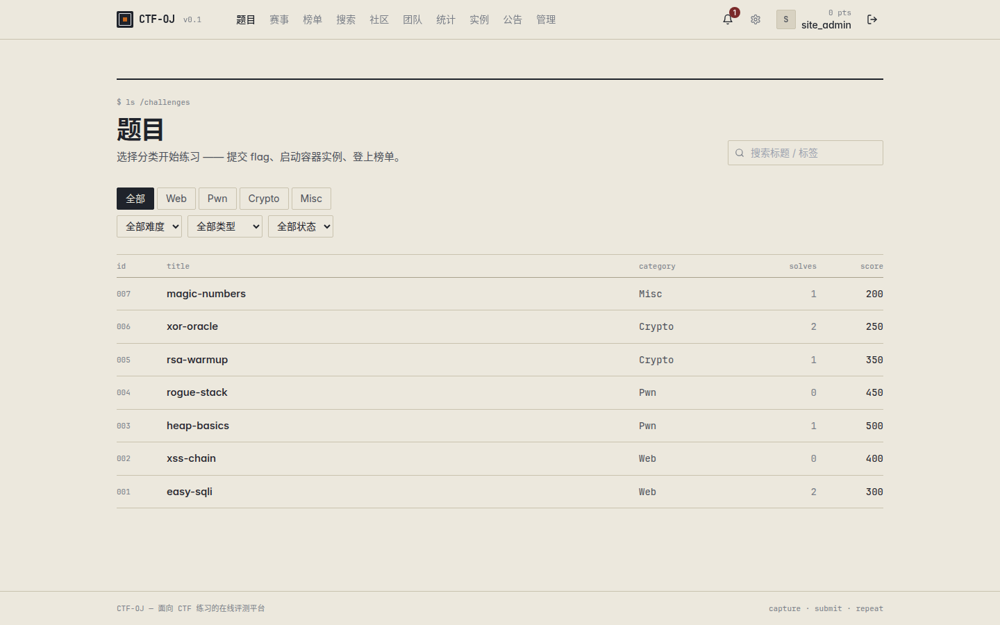
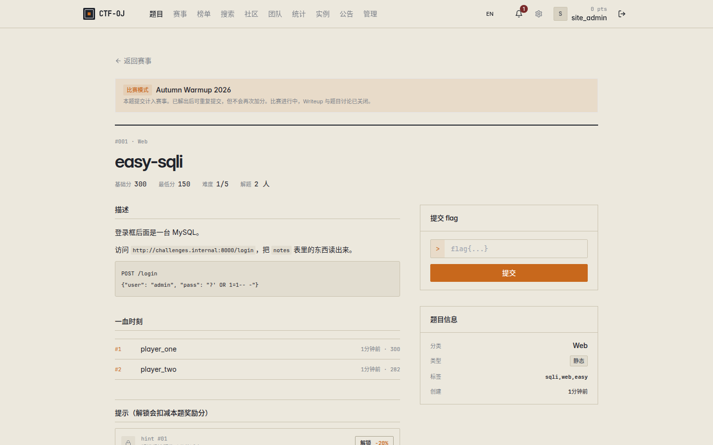
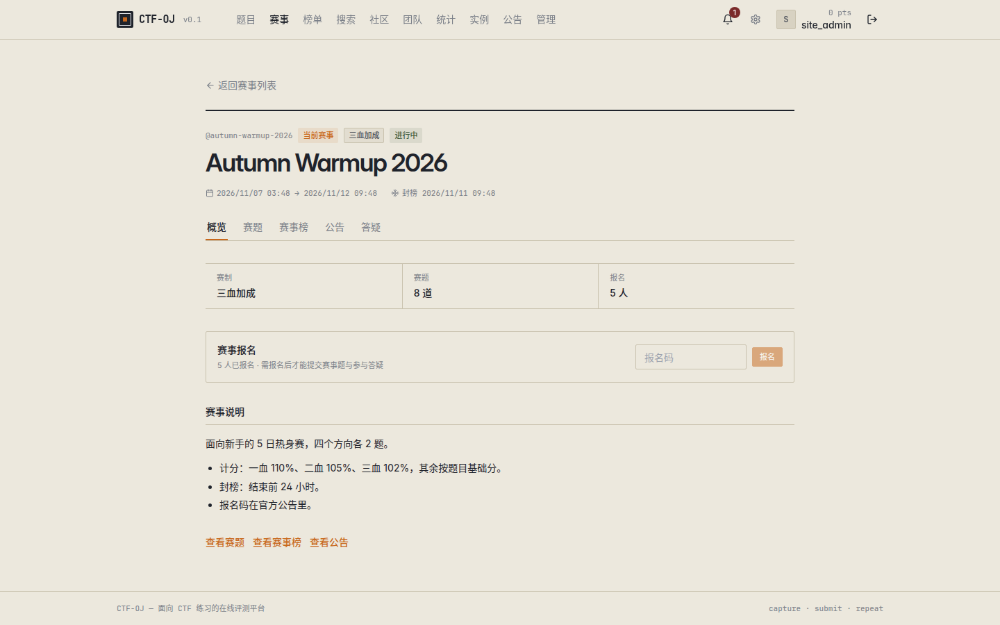
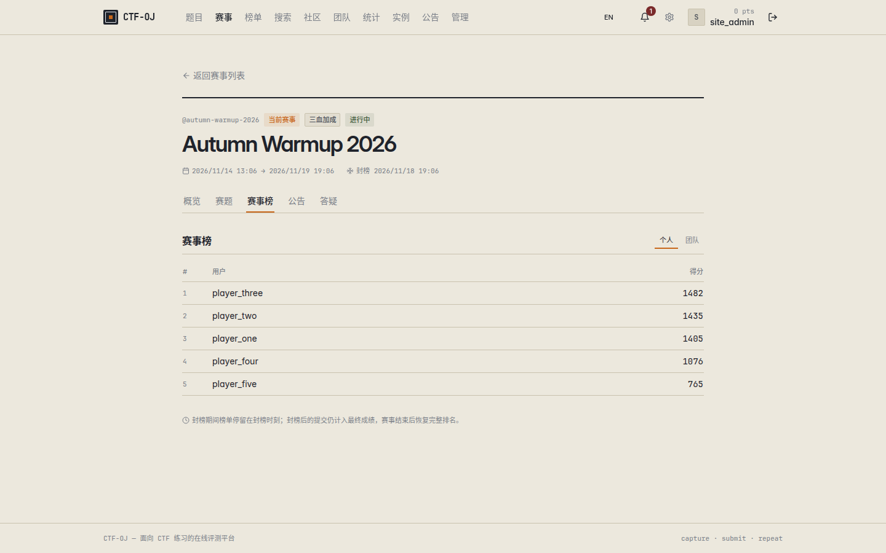
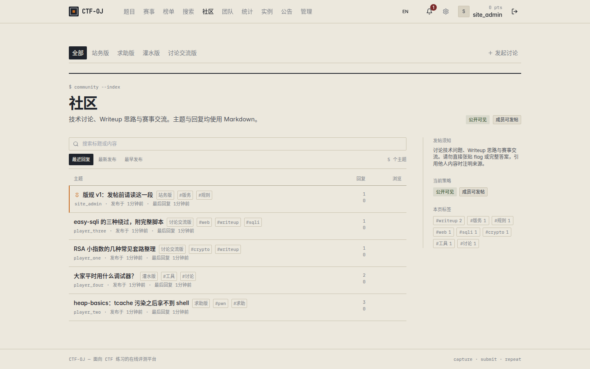

# CTF-OJ

<p align="left">
  <a href="https://github.com/wanwusangzhigit/ctf-oj/actions/workflows/ghcr.yml"></a>
  <a href="LICENSE"></a>
  
  
  
  
  
  
  
</p>

**English** · [简体中文](README.zh-CN.md)

A self-hosted online judge for CTF practice: a scored challenge catalog, on-demand
challenge containers, competitions with registration / scoring modes / board freeze,
a sectioned community forum, teams, and an admin console. Go + React + PostgreSQL,
one `docker compose` file.

| Challenge catalog | Challenge detail |
| --- | --- |
|  |  |

| Competition board | Competition scoreboard | Community sections |
| --- | --- | --- |
|  |  |  |

> Screenshots are captured from a local build of this repository with demo data.
> The demo accounts and challenges shown are not shipped with the software.

---

## Features

### Challenges and judging
- Category and difficulty catalog with search over titles, tags and descriptions.
- Static and regex flag matching, per-challenge flag lists, case sensitivity switch.
- Dynamic scoring (`base / min / decay` by solver count) or fixed scores.
- Challenge states: draft, published, hidden, archived. Hidden challenges are only
  reachable through a live competition that binds them.
- Attachment uploads, per-challenge writeups with their own discussion threads.
- Solution podium and first-blood list per challenge.
- CSV import and export of the challenge catalog.

### Dynamic (containerized) challenges
- Per-challenge image, Dockerfile or Compose source, uploaded into an isolated source
  store and built on demand.
- Player-owned instances with start / restart / extend / stop, host port allocation
  from a configurable range, per-user instance cap and TTL reclamation by a worker.
- Dynamic flag injection per instance; container logs readable from the admin console.

### Competitions
- Registration with optional join code, live / upcoming / finished phases, archiving.
- Scoring modes: `fixed`, `three_blood` (110% / 105% / 102%) and `dynamic`.
- Board freeze (`freeze_at`) with a frozen public board and a live board for organizers.
- Per-competition announcements, per-competition Q&A threads, per-competition solves
  separated from practice solves.
- Score exclusion per registration (with reason and audit trail) and CSV export of
  results for users or teams.

### Community and teams
- Forum organised into sections (boards). Four boards ship by default — 站务版 / 求助版 /
  灌水版 / 讨论交流版 — and boards can be added, renamed or removed.
- Every community topic belongs to a board; replies inherit their topic's board.
- Per-board copy (name, blurb, guidelines in Markdown) and per-board visibility and
  posting policy overrides that fall back to the site-wide policy.
- Site-wide and per-board access grants for users, teams and groups.
- Nested replies, likes, tags, pinning, locking, Markdown body with revision history.
- Teams with invite codes, team roster management, ownership transfer and a team board.
- Notification centre, activity feed, follows, achievements, avatar upload, optional 2FA.

### Administration
- Role-based permissions plus resource-level grants (challenge / competition / board).
- Audited write operations, including delegated operations recorded with the grant used.
- Site settings split by concern: branding, registration, misc, community policy and
  copy, broadcast messaging.
- Permission groups, server/container overview with prune, bulk broadcast to users.

### Operations
- Health endpoint, Prometheus metrics at `/metrics`, WebSocket stream at `/api/v1/realtime`.
- Structured logging with a configurable level, Redis-backed rate limiting and caching.

### Internationalization
- Chinese / English UI with a header switch. The preference is stored in
  `localStorage`; otherwise the browser language decides (Chinese locales get
  Chinese, everything else gets English).
- Dictionaries live in `frontend/src/locales/` and are bundled at build time —
  no CDN and no runtime translation fetch. `i18next` / `react-i18next` are MIT
  licensed and pinned to exact versions.
- Dates, relative times and duration units follow the active locale.
- User-authored content (challenge titles, announcements, board copy, site rules)
  is data, not UI chrome, and is not translated at runtime.
- The switcher sits in the page header; switching reloads the page so that
  module-level labels are re-evaluated under the new language.
- To add UI copy, add the Chinese text as a key to both
  `frontend/src/locales/zh/natural.ts` and `en/natural.ts`, then call
  `i18n.t('中文')`. `npm run typecheck` catches any missing key.

## Tech stack

| Layer | Choice |
| --- | --- |
| Backend | Go 1.22, Gin, GORM, `database/sql`-free, JWT (access + refresh) |
| Data | PostgreSQL 16, Redis 7 |
| Frontend | React 18, TypeScript 5.6 (strict), Vite 5, Tailwind CSS, TanStack Query, Zustand, react-router 6, i18next / react-i18next |
| Infra | Docker Compose, Caddy reverse proxy, GHCR images (`linux/amd64` + `linux/arm64`) |
| Rich text | react-markdown + rehype-sanitize (no `dangerouslySetInnerHTML`) |

## Quick start

Requirements: Docker with the Compose v2 plugin, Linux or macOS. Dynamic challenges
need a Docker daemon reachable by the backend (the compose file mounts
`/var/run/docker.sock`).

### Default deploy

`make deploy` runs unattended and asks nothing:

1. create `.env` from `.env.example` when it is missing, and `chmod 600` it;
2. generate `BACKEND_JWT_SECRET` and the Postgres passwords when they are still the
   shipped placeholders — an existing `pg-data` volume blocks the password rotation,
   because changing them would lock the stack out of its own database;
3. pull the `backend` and `frontend` images, and build locally only if the pull fails
   or stalls past `--pull-timeout` (default 600 seconds);
4. start postgres and redis, apply migrations, start the remaining services;
5. poll `/api/v1/health` for up to 180 seconds, then print the URLs and next steps.

```bash
make deploy                     # http://localhost:8080
```

Prebuilt images mean a fresh host does not need this repository's source tree to
deploy. A pulled `latest` is whatever CI last built, not your working copy — after
changing backend code, deploy the local build instead:

```bash
make deploy ARGS="--source build"
```

Or step by step:

```bash
cp .env.example .env      # then edit the secrets
make up                   # postgres + redis
make migrate              # apply SQL migrations (never runs on boot)
make up-prod              # build + start backend, worker, frontend, caddy
```

Open <http://localhost:8080>. The published port is `${PUBLIC_HTTP_PORT}` (default
`8080`); the backend listens on `8081` inside the network only.

### Custom deploy

```bash
make deploy-custom                                        # the wizard
./scripts/deploy.sh --custom --yes --port 9000 --project ctfoj-demo --source build
./scripts/deploy.sh --custom --dry-run                    # ask, print, change nothing
```

The wizard asks four groups: exposed port / compose project name / code source → image
prefix and tag / registration / instance host and port range → how secrets are handled →
whether to prepare the first administrator. It prints the SQL for the administrator and
never runs it. Each question has an equivalent flag, so `--custom --yes` or a full set
of flags is usable from CI. Every flag also works without `--custom`, which is how the
default mode is customised non-interactively.

Precedence is always **flag > wizard answer > env file > built-in default**.

| Flag | Default | Notes |
| --- | --- | --- |
| `--custom`, `-i` | off | Enter the wizard. Without it the script never reads stdin |
| `--yes`, `-y` | off | Answer every question with its default; required for `--custom` without a TTY |
| `--lang zh\|en` | detected | See [Languages](#languages) |
| `--source pull\|build\|auto` | `auto` | `auto` pulls and falls back to a local build; `pull` fails instead of falling back; `build` never pulls |
| `--pull-timeout N` | `600` | Seconds to wait for the pull, `0` for no limit. A registry that answers the manifest and then stalls on the blobs is otherwise indistinguishable from a slow link, and the fallback would never fire. Hosts without the `timeout` command warn and pull unbounded |
| `--port N` | existing `PUBLIC_HTTP_PORT`, else `8080` | Published port; warns when another project already holds it |
| `--project NAME` | existing `COMPOSE_PROJECT_NAME`, else `ctfoj` | Volumes and networks are named after it — a new name starts empty. Written into the env file, so the follow-up commands the script prints hit the same stack instead of the old one |
| `--registry PREFIX` | `ghcr.io/wanwusangzhigit/ctf-oj` | Point at a mirror or your own registry |
| `--tag TAG` | `latest` | Image tag to pull or build |
| `--register open\|closed` | `open` | `BACKEND_REGISTER_OPEN` |
| `--instance-host H` | `localhost` | Host players reach instance ports on |
| `--instance-port-range MIN-MAX` | `30000-40000` | `MIN` must be lower than `MAX` |
| `--secrets auto\|manual` | `auto` | `manual` generates nothing and warns about placeholders; the wizard never asks for a secret value |
| `--admin USERNAME` | — | Substituted into the printed SQL (default `YOUR_NAME`); still only printed |
| `--env-file PATH` | `.env` | Deploy a second instance without touching the first one's credentials. A file copied from `.env.example` still says `COMPOSE_PROJECT_NAME=ctfoj`, so pair it with `--project` — otherwise `docker compose -p … down -v` against it destroys the original stack, and the script warns when it sees this combination |
| `--dry-run` | off | Print every command; no file is written, no container starts |
| `--no-build` | — | Legacy spelling of `--source pull` |
| `--skip-migrate` | — | Skip `scripts/migrate.sh` |

### Languages

Both messages and the wizard are available in Chinese and English. The language is
chosen by `--lang zh|en`, then `CTF_OJ_LANG`, then `LC_ALL` / `LANG` when it starts with
`zh` or `en`; a bare `C` / `POSIX` locale counts as undetectable and falls back to
Chinese. `--lang en` on a zh host changes only the text — the command sequence is
byte-identical. This controls the deploy script's own output only; the web UI
language is chosen independently in the browser (see Internationalization).

### Development loop

```bash
make up                   # postgres + redis only
make backend-dev          # go run ./cmd/server  (http://localhost:8081)
make frontend-dev         # vite dev server      (http://localhost:5173)
```

The dev server proxies `/api` to the backend; see `frontend/vite.config.ts`.

## First administrator

There is no built-in account and no seeded data — migrations create schema only.
Register through the UI, then promote your account:

```bash
docker compose exec -T postgres sh -c \
  'psql -U "$POSTGRES_USER" -d "$POSTGRES_DB" -c "UPDATE users SET role='"'"'admin'"'"' WHERE username='\''YOUR_NAME'\'';"'
```

Log out and back in so the new role lands in your token. Everything else —
categories, challenges, competitions, community boards — is created in the admin
console.

`scripts/deploy.sh` prints this as its last step, with the env file, database name and
user already filled in (substitute your username, or pass `--admin NAME`). It prints the
command and never runs it.

## Configuration

All values are read from the environment; `make deploy` writes a `.env` with fresh
secrets and `chmod 600` on it. Defaults below are the shipped ones.

| Variable | Default | Notes |
| --- | --- | --- |
| `POSTGRES_HOST` / `POSTGRES_PORT` | `postgres` / `5432` | Override for a source-run backend |
| `POSTGRES_DB` / `POSTGRES_USER` | `ctfoj` / `ctfoj` | |
| `POSTGRES_PASSWORD` | `change_me_in_production` | **Change this** |
| `POSTGRES_ROOT_PASSWORD` | `change_me_in_production` | Generated by `make deploy`; nothing in the stack reads it today — the official image uses `POSTGRES_PASSWORD` for its superuser |
| `REDIS_ADDR` | `redis:6379` | |
| `REDIS_PASSWORD` / `REDIS_DB` | empty / `0` | |
| `BACKEND_HTTP_ADDR` | `:8081` | Container-internal listen address |
| `BACKEND_LOG_LEVEL` | `info` | `debug` / `info` / `warn` / `error` |
| `BACKEND_JWT_SECRET` | `replace_with_a_long_random_string` | **Change this**; signing key for every token |
| `BACKEND_JWT_ACCESS_TTL` | `15m` | Access token lifetime |
| `BACKEND_JWT_REFRESH_TTL` | `720h` | Refresh token lifetime |
| `BACKEND_REGISTER_OPEN` | `true` | Set `false` to close self-service registration |
| `BACKEND_STORAGE_DRIVER` | `local` | Only `local` is implemented |
| `BACKEND_STORAGE_LOCAL_DIR` | `/data/uploads` | Attachment store (named volume) |
| `BACKEND_RATE_LIMIT_RPM` | `120` | Requests per minute per client |
| `BACKEND_INSTANCE_PUBLIC_HOST` | `localhost` | Host players reach instance ports on |
| `BACKEND_INSTANCE_PORT_MIN` / `MAX` | `30000` / `40000` | Host port range for dynamic challenges |
| `BACKEND_INSTANCE_DEFAULT_TTL` | `2h` | Instance lifetime before the worker reclaims it |
| `BACKEND_INSTANCE_MAX_PER_USER` | `1` | Concurrent instances per player |
| `BACKEND_INSTANCE_FLAG_PREFIX` | `flag` | Prefix of injected dynamic flags |
| `WORKER_INTERVAL_SECONDS` | `30` | TTL / cleanup sweep interval |
| `PUBLIC_HTTP_PORT` | `8080` | The only published port |
| `COMPOSE_PROJECT_NAME` | `ctfoj` | Prefix of the volumes and networks this stack owns |
| `CTFOJ_IMAGE_PREFIX` | `ghcr.io/wanwusangzhigit/ctf-oj` | Where `backend` / `frontend` images are pulled from and tagged |
| `CTFOJ_IMAGE_TAG` | `latest` | Image tag used by both services |

Advanced variables that are not in `.env.example` but are honoured by the backend:

| Variable | Default | Notes |
| --- | --- | --- |
| `BACKEND_PUBLIC_URL` | `http://localhost:8080` | Used in generated links and emails |
| `BACKEND_MAILER_DRIVER` | `console` | `console` logs the message, `smtp` sends, `off` disables |
| `BACKEND_MAILER_FROM` / `BACKEND_SMTP_FROM` | `noreply@ctf-oj.local` | Sender address |
| `BACKEND_SMTP_HOST` / `BACKEND_SMTP_PORT` | empty / `587` | |
| `BACKEND_SMTP_USER` / `BACKEND_SMTP_PASS` / `BACKEND_SMTP_USE_TLS` | empty / empty / `true` | |
| `BACKEND_DOCKER_HOST` | `unix:///var/run/docker.sock` | Parsed but **never read**: the orchestrator shells out to the `docker` CLI, so only the process's own `DOCKER_HOST` has any effect |
| `BACKEND_DOCKER_NETWORK` | empty | Parsed but **never read** — nothing assigns `Instance.NetworkName`, and `docker run` is invoked without `--network`; player instances publish into the host port range and are reached through `BACKEND_INSTANCE_PUBLIC_HOST` |
| `BACKEND_CHALLENGE_SOURCE_DIR` | `./data/challenge_sources` (`/data/challenge_sources` in containers) | Source store for Dockerfile/Compose challenges |
| `BACKEND_CORS_ORIGINS` | `*` | Comma-separated list; tighten for production |

Email is used for address verification, password reset and admin broadcasts. With the
default `console` driver those messages go to the backend log instead of the network.

## Make targets

| Target | What it does |
| --- | --- |
| `deploy` | `scripts/deploy.sh`: secrets, image pull (local build on failure), migrations, health check |
| `deploy-custom` | `scripts/deploy.sh --custom`: the same through a bilingual wizard; pass `ARGS="--yes --port 9000"` to script it |
| `up` | Start postgres and redis |
| `down` | Stop the stack, keep volumes |
| `migrate` | Apply pending migrations and record them in `schema_migrations` |
| `up-prod` | Build images and start the full stack behind Caddy |
| `build` | Build the backend and frontend images |
| `backend-dev` | Run the backend on the host with `go run ./cmd/server` |
| `frontend-dev` | Run Vite on the host |
| `logs` | Tail compose logs |
| `psql` / `redis-cli` | Connect to the databases using `.env` credentials |
| `fmt` / `vet` / `test` | Go toolchain |
| `backup` | `pg_dump -Fc` into `backups/ctfoj-<timestamp>.dump` (git-ignored) |
| `restore FILE=…` | Restore a dump; requires typing the database name to confirm |
| `clean` | **Destroys containers and volumes** (`down -v --remove-orphans`) |

## Architecture

```
api  ->  service  ->  domain  <-  repository
```

- `api/v1` — HTTP handlers: bind, authorize, call one service, respond. Never touches
  a repository.
- `service` — business rules and authorization decisions.
- `domain` — entities, errors, repository interfaces. No GORM.
- `repository` — the only layer that uses GORM.
- `infrastructure` — db, cache, storage, docker, mailer, metrics, realtime, logger.

Every response uses the same envelope:

```json
{ "code": 0, "data": { }, "message": "ok" }
```

`code != 0` for business errors with a semantic HTTP status (`400/401/403/404/409/429/500`).
List endpoints take `?page=1&page_size=20` and return `{ items, total, page, page_size }`.
Sessions are HttpOnly cookies (`ctf_oj_access` / `ctf_oj_refresh`) and `Authorization:
Bearer <accessToken>` is accepted as well.

```
backend/
  cmd/server            entrypoints (server, worker)
  internal/             api, middleware, domain, service, repository, infrastructure
  migrations/           plain SQL, NNNNNN_name.up.sql / .down.sql
  scripts/migrate.sh    migration runner
frontend/
  src/api               one module per resource
  src/pages             route pages (public + admin)
  src/components        business components, ui/ primitives
  src/hooks src/stores src/lib src/types src/styles
  src/locales            zh/en dictionaries, i18n init, browser-language detection
deploy/caddy/Caddyfile  reverse proxy config
scripts/                deploy.sh, migrate.sh
.github/                issue forms, PR template, workflows, screenshot assets
docker-compose.yml      postgres, redis, backend, worker, frontend, caddy
.env.example            every variable the stack reads, with its default
```

## Testing

```bash
make vet                # go vet ./...
make test               # go test ./...   (table-driven, no database required)
cd frontend && npm run typecheck && npm run build
```

There is no frontend test runner in this repository. Page-level regressions are run
against a local instance with browser automation scripts that are deliberately not
committed.

## Deployment and images

The compose file defines six services:

| Service | Purpose | Port |
| --- | --- | --- |
| `postgres` | primary datastore | internal `5432` |
| `redis` | rate limiting, cache, sessions | internal `6379` |
| `backend` | API server | internal `8081`, mounts the Docker socket |
| `worker` | TTL and cleanup sweeps | none |
| `frontend` | static SPA bundle | internal `80` |
| `caddy` | reverse proxy, TLS automation | `${PUBLIC_HTTP_PORT:-8080}` → `80` |

Named volumes: `pg-data`, `redis-data`, `uploads`, `challenge-sources`, `caddy-data`,
`caddy-config`.

Prebuilt images are published for `linux/amd64` and `linux/arm64`:

```bash
docker pull ghcr.io/wanwusangzhigit/ctf-oj/backend:latest
docker pull ghcr.io/wanwusangzhigit/ctf-oj/frontend:latest
```

`backend`, `worker` and `frontend` each carry both an `image:` and a `build:` key, so
the same compose file works pulled or built. `worker` intentionally reuses the backend
image with a different entrypoint. `--registry` points the whole stack at a mirror or
your own registry — it rewrites `CTFOJ_IMAGE_PREFIX`, which both the pull and the local
build tag read.

One consequence of the shared name: `--source build` overwrites the local copy of
`ghcr.io/.../backend:latest`, so after that the tag no longer matches what CI published
until the next `--source pull`.

Pull requests build the images but do not push them.

## Backup and restore

```bash
make backup                    # writes backups/ctfoj-<UTC timestamp>.dump
make restore FILE=backups/ctfoj-20260101T120000Z.dump
```

`backups/` and `*.dump` are git-ignored — a dump contains every account, flag and
submission. Restore overwrites the live database and asks you to type the database
name to confirm.

## Roadmap

- **P1** Foundation: compose, config, migrations, auth, health ✅
- **P2** Core challenges: categories, CRUD, static/regex flags, judging, attachments, dynamic scoring ✅
- **P3** Containerized challenges: orchestration, dynamic flags, instance lifecycle, TTL worker ✅
- **P4** Community: announcements, threaded discussions, Markdown, notification centre ✅
- **P5** Admin console and advanced features: realtime scoreboard, statistics, import/export ✅ (ongoing polish)
- **P6** Internationalization: full Chinese/English UI, locally bundled dictionaries,
  browser-language detection ✅

Known gaps, stated plainly:

- No frontend unit test framework.
- No OpenAPI or generated contract documentation; the handlers are the specification.
- Runtime translation covers UI chrome only; site-authored content and built-in community copy defaults stay in the language they were written in.
- CI builds images but does not run the test suites.
- `local` is the only storage driver; there is no S3-compatible backend.
- Deleting a community board with topics in it is refused rather than archived.

## Contributing

Read [CONTRIBUTING.md](.github/CONTRIBUTING.md) for the layering rules, migration
policy and the checks a pull request is expected to pass. Use the
[issue forms](https://github.com/wanwusangzhigit/ctf-oj/issues/new/choose) for bugs
and feature requests. Report vulnerabilities as described in [SECURITY.md](.github/SECURITY.md)
instead of opening a public issue.

## License

GPL-3.0-only, see [LICENSE](LICENSE).
