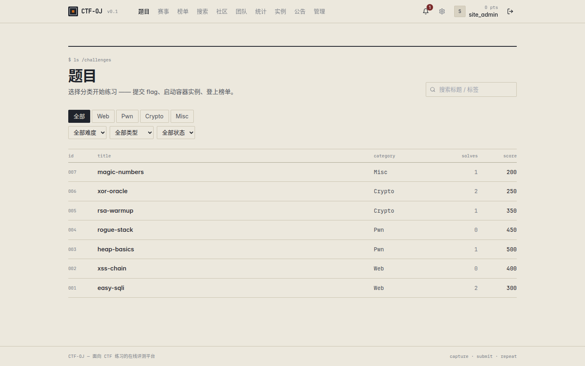
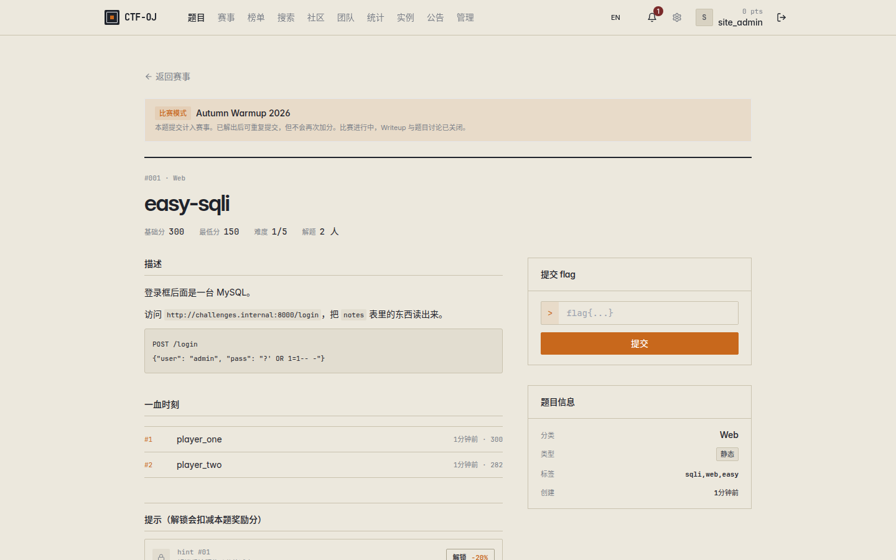
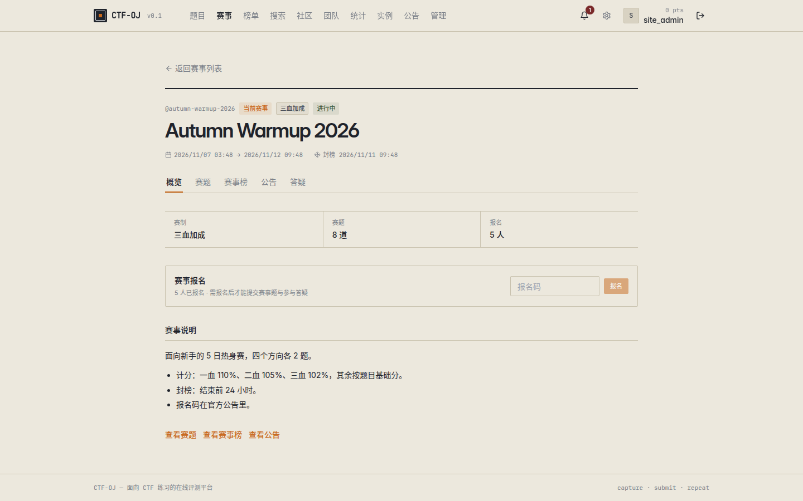
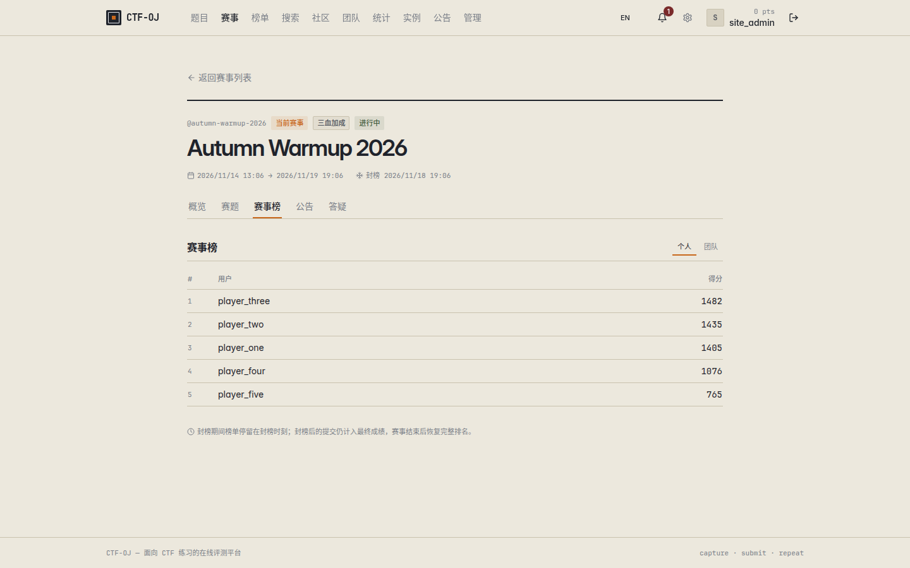
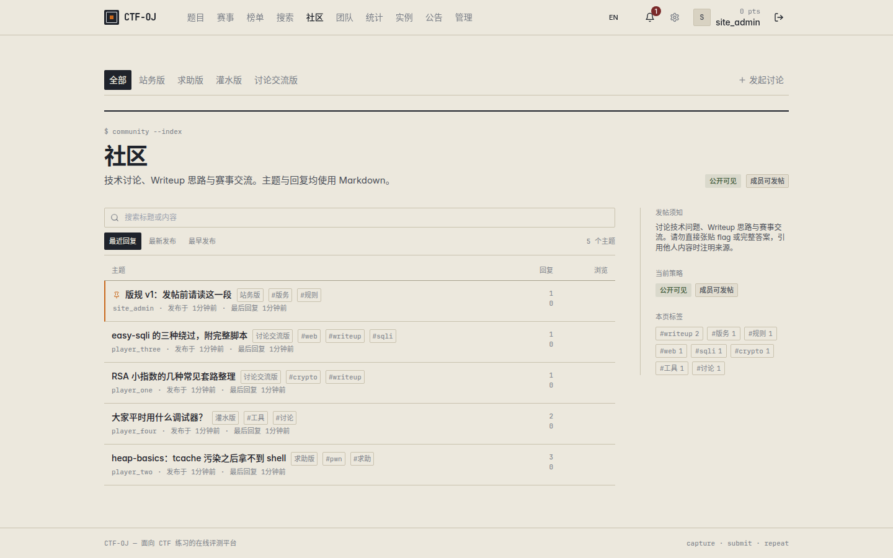

# CTF-OJ

<p align="left">
  <a href="https://github.com/wanwusangzhigit/ctf-oj/actions/workflows/ghcr.yml"></a>
  <a href="LICENSE"></a>
  
  
  
  
  
  
  
</p>

[English](README.md) · **简体中文**

面向 CTF 练习的自托管在线评测系统：带计分的题库、按需启动的题目容器、支持报名与封榜的
赛事、按板块组织的社区讨论、团队与后台管理。Go + React + PostgreSQL，一个 `docker compose`
文件即可跑起来。

| 题库 | 题目详情 |
| --- | --- |
|  |  |

| 赛事概览 | 赛事榜 | 社区板块 |
| --- | --- | --- |
|  |  |  |

> 截图来自本仓库的本地构建，使用临时演示数据拍摄。演示账号与题目不随软件分发。

---

## 功能

### 题目与判题
- 分类与难度目录，支持按标题、标签、描述搜索。
- static 与 regex 两类 flag，单题可配多个 flag，可选大小写敏感。
- 动态计分（`基础分 / 最低分 / 衰减`，按解题人数衰减）或固定分值。
- 题目状态：草稿、已发布、隐藏、归档。隐藏题只有被进行中的赛事显式绑定后才能访问。
- 题目附件、独立 writeup 及各自的讨论区。
- 单题领奖台与一血列表。
- 题库 CSV 导入导出。

### 动态（容器化）题目
- 题目可用 image、Dockerfile 或 Compose 三种来源，源码上传到隔离目录后按需构建。
- 选手自有实例的启动 / 重启 / 续期 / 停止，主机端口从可配置区间分配，单用户实例数上限，
  由 worker 按 TTL 回收。
- 每个实例注入独立 flag；后台可查看容器日志。

### 赛事
- 报名与取消报名在开赛时统一关闭；报名码仅在必须报名时校验。
- 比赛进行中，题目无论从哪个入口进入都自动计入赛事，其 Writeup 与讨论一并锁定，不带 `competition_id` 也无法绕过。
- 计分模式：`fixed`、`three_blood`（110% / 105% / 102%）、`dynamic`。
- 封榜（`freeze_at`）：封榜后公开榜只统计封榜前的解题，管理员与赛事管理者看实时榜。
- 赛事公告、赛事答疑线程；赛事解题与练习解题分开记录。
- 按报名记录取消成绩（附原因并写审计），成绩可按个人或团队导出 CSV。

### 社区与团队
- 讨论区按**板块**组织，默认四块：站务版 / 求助版 / 灌水版 / 讨论交流版，可新增、改名、删除。
- 发帖必须选择板块，回复自动继承主题所在板块。
- 每个板块有自己的文案（名称、简介、Markdown 版规）与可见性 / 发帖策略覆盖，未设置时沿用全站策略。
- 全站与板块两级授权，主体可以是用户、团队或权限组。
- 嵌套回复、点赞、标签、置顶、锁定、Markdown 正文与历史版本。
- 团队邀请码、成员管理、队长转让、团队榜。
- 通知中心、活动流、关注、成就、头像上传、可选两步验证。

### 后台管理
- 角色权限 + 资源级授权（题目 / 赛事 / 板块）。
- 写操作全部进审计，被授权（delegated）操作会记录所使用的授权项。
- 站点设置按职责分页：品牌、注册、杂项、社区策略与文案、群发。
- 权限组、服务器与容器总览（含 prune）、向全体用户群发。

### 运维
- 健康检查、`/metrics` 暴露 Prometheus 指标、`/api/v1/realtime` WebSocket 推送。
- 结构化日志可调级别，限流与缓存走 Redis。

### 国际化
- 中英双语界面，页头可切换；偏好写入 `localStorage`，未设置时跟随浏览器语言（中文环境用中文，其余用英文）。
- 字典位于 `frontend/src/locales/`，随构建本地打包，不依赖 CDN 或运行时远端拉取；`i18next` / `react-i18next` 为 MIT 许可并固定精确版本。
- 日期、相对时间与时长单位随当前语言变化。
- 用户创建的内容（题目标题、公告、板块文案、站点规则）属于数据层，不做运行时翻译。
- 切换器位于页头；切换会整页刷新，让模块级常量也按新语言重新求值。
- 新增文案时，把中文原文作为 key 同时写入 `frontend/src/locales/zh/natural.ts` 与 `en/natural.ts`，组件里调用 `i18n.t('中文原文')`；漏 key 会被 `npm run typecheck` 拦下。

## 技术栈

| 层 | 选型 |
| --- | --- |
| 后端 | Go 1.22、Gin、GORM、JWT（access + refresh 双令牌） |
| 数据 | PostgreSQL 16、Redis 7 |
| 前端 | React 18、TypeScript 5.6（strict）、Vite 5、Tailwind CSS、TanStack Query、Zustand、react-router 6、i18next / react-i18next |
| 基础设施 | Docker Compose、Caddy 反向代理、GHCR 镜像（`linux/amd64` + `linux/arm64`） |
| 富文本 | react-markdown + rehype-sanitize（不使用 `dangerouslySetInnerHTML`） |

## 快速开始

前置：Docker 与 Compose v2 插件，Linux 或 macOS。动态题目需要后端能访问一个 Docker
daemon（compose 文件挂载了 `/var/run/docker.sock`）。

### 默认部署

`make deploy` 全程无人值守、一个问题都不问：

1. `.env` 不存在时从 `.env.example` 复制，并 `chmod 600`；
2. `BACKEND_JWT_SECRET` 与 Postgres 密码仍是内置占位值时随机生成 —— 但只要 `pg-data`
   卷已存在就不轮换数据库密码，改了密码等于把自己锁在库外面；
3. 拉取 `backend` 与 `frontend` 镜像，拉不到、或在 `--pull-timeout`（默认 600 秒）内卡死
   才本地构建；
4. 启动 postgres 与 redis、执行迁移、启动其余服务；
5. 轮询 `/api/v1/health` 最多 180 秒，然后打印地址与后续步骤。

```bash
make deploy                     # http://localhost:8080
```

镜像是预构建的，所以一台干净主机不需要本仓库源码也能部署。注意拉到的 `latest` 是 CI
最后一次构建的产物，不是你当前的工作副本 —— 改过后端代码请改用本地构建：

```bash
make deploy ARGS="--source build"
```

分步执行：

```bash
cp .env.example .env      # 然后改掉密钥
make up                   # postgres + redis
make migrate              # 执行 SQL 迁移（服务启动不会自动迁移）
make up-prod              # 构建并启动 backend、worker、frontend、caddy
```

访问 <http://localhost:8080>。对外端口是 `${PUBLIC_HTTP_PORT}`（默认 `8080`），后端只在
容器网络内的 `8081` 监听。

### 自定义部署

```bash
make deploy-custom                                        # 进向导
./scripts/deploy.sh --custom --yes --port 9000 --project ctfoj-demo --source build
./scripts/deploy.sh --custom --dry-run                    # 照问，但只打印、不落地
```

向导分四组提问：对外端口 / compose 项目名 / 代码来源 → 镜像前缀与 tag / 注册开关 /
实例公网地址与端口区间 → 密钥处理方式 → 是否现在准备第一个管理员。管理员那一步**只打印
SQL，绝不代跑**。每个问题都有等价命令行参数，`--custom --yes` 或干脆只给参数就能在 CI
里跑。所有参数不加 `--custom` 也生效，那就是「非交互地自定义默认部署」。

优先级恒为 **命令行参数 > 向导回答 > env 文件 > 内置默认值**。

| 参数 | 默认值 | 说明 |
| --- | --- | --- |
| `--custom`、`-i` | 关 | 进入向导。不加则脚本全程不读 stdin |
| `--yes`、`-y` | 关 | 全部用默认值回答；无 TTY 时想用 `--custom` 必须带它 |
| `--lang zh\|en` | 自动检测 | 见下方「语言」 |
| `--source pull\|build\|auto` | `auto` | `auto` 拉取失败自动本地构建；`pull` 失败即失败、不回退；`build` 完全不拉 |
| `--pull-timeout N` | `600` | 拉取等待上限（秒），`0` 为不限。仓库读完 manifest 就卡在镜像层时，看起来跟网速慢一模一样，不设上限就永远等不到回退。宿主机没有 `timeout` 命令时会警告一句并按不限处理 |
| `--port N` | 现有 `PUBLIC_HTTP_PORT`，否则 `8080` | 对外端口；被别的项目占用时会警告 |
| `--project NAME` | 现有 `COMPOSE_PROJECT_NAME`，否则 `ctfoj` | 卷与网络都按它命名，换名字等于换一套空数据。它会写进 env 文件，因此脚本结尾打印的后续命令落在同一套栈上，而不是旧的那套 |
| `--registry PREFIX` | `ghcr.io/wanwusangzhigit/ctf-oj` | 指向自建 mirror 或私有仓库 |
| `--tag TAG` | `latest` | 拉取或构建的 tag |
| `--register open\|closed` | `open` | `BACKEND_REGISTER_OPEN` |
| `--instance-host H` | `localhost` | 选手访问实例端口的地址 |
| `--instance-port-range MIN-MAX` | `30000-40000` | 要求 `MIN` < `MAX` |
| `--secrets auto\|manual` | `auto` | `manual` 不生成也不覆盖，只在仍是占位值时强警告；向导任何时候都不读取密码 |
| `--admin USERNAME` | — | 把打印的 SQL 里的 `YOUR_NAME` 换成它，仍然只打印 |
| `--env-file PATH` | `.env` | 部署第二套实例，不去碰第一套的密钥。注意从 `.env.example` 复制出来的文件项目名仍是 `ctfoj`，必须配合 `--project` 用 —— 否则事后一条 `docker compose -p … down -v` 就会把原来那套连卷删掉；看到这个组合脚本会警告 |
| `--dry-run` | 关 | 只打印将执行的命令，不改文件、不起容器 |
| `--no-build` | — | 旧写法，等价 `--source pull` |
| `--skip-migrate` | — | 跳过 `scripts/migrate.sh` |

### 语言

提示文案与向导都提供中英两套。选择顺序：`--lang zh|en` > `CTF_OJ_LANG` > `LC_ALL` /
`LANG` 以 `zh` 或 `en` 开头；纯 `C` / `POSIX` 视为检测不到，兜底中文。同一套命令序列在
`--lang zh` 与 `--lang en` 下逐字节相同，变的只有文案。这里只控制部署脚本自身的输出；网页界面语言在浏览器里独立选择（见「国际化」）。

### 开发模式

```bash
make up                   # 只起 postgres + redis
make backend-dev          # go run ./cmd/server  （http://localhost:8081）
make frontend-dev         # vite 开发服务器      （http://localhost:5173）
```

开发服务器把 `/api` 代理到后端，见 `frontend/vite.config.ts`。

## 第一个管理员

系统没有内置账号，迁移也只建表不写数据。先在页面注册，再把自己的账号提为管理员：

```bash
docker compose exec -T postgres sh -c \
  'psql -U "$POSTGRES_USER" -d "$POSTGRES_DB" -c "UPDATE users SET role='"'"'admin'"'"' WHERE username='\''你的用户名'\'';"'
```

退出后重新登录，新角色才会写进令牌。分类、题目、赛事、社区板块都在后台创建。

`scripts/deploy.sh` 收尾会把这一步打印出来，env 文件、库名、用户名都已填好（把用户名换成
自己的，或直接用 `--admin NAME`）。它只打印，绝不代跑。

## 配置

所有配置从环境变量读取；`make deploy` 会生成带随机密钥的 `.env` 并 `chmod 600`。下表默认值
即仓库内置值。

| 变量 | 默认值 | 说明 |
| --- | --- | --- |
| `POSTGRES_HOST` / `POSTGRES_PORT` | `postgres` / `5432` | 宿主机直接跑后端时改这里 |
| `POSTGRES_DB` / `POSTGRES_USER` | `ctfoj` / `ctfoj` | |
| `POSTGRES_PASSWORD` | `change_me_in_production` | **必须修改** |
| `POSTGRES_ROOT_PASSWORD` | `change_me_in_production` | 由 `make deploy` 生成，当前栈并不读取它——官方镜像用 `POSTGRES_PASSWORD` 作为超级用户口令 |
| `REDIS_ADDR` | `redis:6379` | |
| `REDIS_PASSWORD` / `REDIS_DB` | 空 / `0` | |
| `BACKEND_HTTP_ADDR` | `:8081` | 容器内监听地址 |
| `BACKEND_LOG_LEVEL` | `info` | `debug` / `info` / `warn` / `error` |
| `BACKEND_JWT_SECRET` | `replace_with_a_long_random_string` | **必须修改**；所有签名的密钥 |
| `BACKEND_JWT_ACCESS_TTL` | `15m` | access token 有效期 |
| `BACKEND_JWT_REFRESH_TTL` | `720h` | refresh token 有效期 |
| `BACKEND_REGISTER_OPEN` | `true` | 设为 `false` 关闭自助注册 |
| `BACKEND_STORAGE_DRIVER` | `local` | 目前只实现了 `local` |
| `BACKEND_STORAGE_LOCAL_DIR` | `/data/uploads` | 附件存储目录（命名卷） |
| `BACKEND_RATE_LIMIT_RPM` | `120` | 单客户端每分钟请求数 |
| `BACKEND_INSTANCE_PUBLIC_HOST` | `localhost` | 选手访问实例端口时使用的主机名 |
| `BACKEND_INSTANCE_PORT_MIN` / `MAX` | `30000` / `40000` | 动态题目的主机端口区间 |
| `BACKEND_INSTANCE_DEFAULT_TTL` | `2h` | 实例存活时长，超时由 worker 回收 |
| `BACKEND_INSTANCE_MAX_PER_USER` | `1` | 单用户并发实例数 |
| `BACKEND_INSTANCE_FLAG_PREFIX` | `flag` | 注入动态 flag 的前缀 |
| `WORKER_INTERVAL_SECONDS` | `30` | TTL / 清理轮询间隔 |
| `PUBLIC_HTTP_PORT` | `8080` | 唯一对外暴露的端口 |
| `COMPOSE_PROJECT_NAME` | `ctfoj` | 这套栈拥有的卷与网络的前缀 |
| `CTFOJ_IMAGE_PREFIX` | `ghcr.io/wanwusangzhigit/ctf-oj` | `backend` / `frontend` 镜像从哪里拉、本地构建又打成什么名 |
| `CTFOJ_IMAGE_TAG` | `latest` | 两个服务共用的 tag |

`.env.example` 里没有、但后端会读取的高级变量：

| 变量 | 默认值 | 说明 |
| --- | --- | --- |
| `BACKEND_PUBLIC_URL` | `http://localhost:8080` | 生成邮件与外链时使用 |
| `BACKEND_MAILER_DRIVER` | `console` | `console` 只写日志，`smtp` 真实发送，`off` 关闭 |
| `BACKEND_MAILER_FROM` / `BACKEND_SMTP_FROM` | `noreply@ctf-oj.local` | 发件人 |
| `BACKEND_SMTP_HOST` / `BACKEND_SMTP_PORT` | 空 / `587` | |
| `BACKEND_SMTP_USER` / `BACKEND_SMTP_PASS` / `BACKEND_SMTP_USE_TLS` | 空 / 空 / `true` | |
| `BACKEND_DOCKER_HOST` | `unix:///var/run/docker.sock` | 只解析、**从不被读取**：编排器直接 exec 宿主的 `docker` CLI，真正起作用的只有进程自身的 `DOCKER_HOST` |
| `BACKEND_DOCKER_NETWORK` | 空 | 只解析、**从不被读取**：没有任何地方给 `Instance.NetworkName` 赋值，`docker run` 也不带 `--network`；选手实例靠发布到宿主端口访问，地址由 `BACKEND_INSTANCE_PUBLIC_HOST` 决定 |
| `BACKEND_CHALLENGE_SOURCE_DIR` | `./data/challenge_sources`（容器内 `/data/challenge_sources`） | Dockerfile / Compose 题目的源码目录 |
| `BACKEND_CORS_ORIGINS` | `*` | 逗号分隔，生产环境请收紧 |

邮件用于邮箱验证、密码重置和后台群发。默认的 `console` 驱动只把这些邮件写进后端日志，
不发到网络。

## Make 目标

| 目标 | 作用 |
| --- | --- |
| `deploy` | `scripts/deploy.sh`：密钥、拉取镜像（拉不到本地构建）、迁移、健康检查 |
| `deploy-custom` | `scripts/deploy.sh --custom`：同样的事走中英双语向导；`ARGS="--yes --port 9000"` 可脚本化 |
| `up` | 启动 postgres 与 redis |
| `down` | 停止服务，保留数据卷 |
| `migrate` | 执行未应用的迁移并记录到 `schema_migrations` |
| `up-prod` | 构建镜像并通过 Caddy 启动完整栈 |
| `build` | 构建后端与前端镜像 |
| `backend-dev` | 在宿主机 `go run ./cmd/server` |
| `frontend-dev` | 在宿主机跑 Vite |
| `logs` | 跟踪 compose 日志 |
| `psql` / `redis-cli` | 用 `.env` 里的凭据连接数据库 |
| `fmt` / `vet` / `test` | Go 工具链 |
| `backup` | `pg_dump -Fc` 导出到 `backups/ctfoj-<时间戳>.dump`（已被 git 忽略） |
| `restore FILE=…` | 恢复导出文件，需要手动输入库名确认 |
| `clean` | **销毁容器与数据卷**（`down -v --remove-orphans`） |

## 架构

```
api  ->  service  ->  domain  <-  repository
```

- `api/v1`：HTTP handler，负责绑定参数、鉴权、调用一个 service、返回结果，不碰仓储。
- `service`：业务规则与权限判定。
- `domain`：实体、错误、仓储接口，不依赖 GORM。
- `repository`：唯一使用 GORM 的一层。
- `infrastructure`：db、cache、storage、docker、mailer、metrics、realtime、logger。

所有响应使用统一信封：

```json
{ "code": 0, "data": { }, "message": "ok" }
```

业务错误 `code != 0`，HTTP 状态码保持语义化（`400/401/403/404/409/429/500`）。列表接口固定
接收 `?page=1&page_size=20`，返回 `{ items, total, page, page_size }`。会话默认走 HttpOnly
cookie（`ctf_oj_access` / `ctf_oj_refresh`），同时接受 `Authorization: Bearer <accessToken>`。

```
backend/
  cmd/server            入口（server、worker）
  internal/             api、middleware、domain、service、repository、infrastructure
  migrations/           纯 SQL 迁移，NNNNNN_name.up.sql / .down.sql
  scripts/migrate.sh    迁移执行器
frontend/
  src/api               按资源拆分的请求模块
  src/pages             路由页面（公开侧 + 后台）
  src/components        业务组件，ui/ 是基础组件
  src/hooks src/stores src/lib src/types src/styles
  src/locales            zh/en 字典、i18n 初始化、浏览器语言检测
deploy/caddy/Caddyfile  反向代理配置
scripts/                deploy.sh、migrate.sh
.github/                issue 表单、PR 模板、workflow、截图资源
docker-compose.yml      postgres、redis、backend、worker、frontend、caddy
.env.example            栈会读取的全部变量及默认值
```

## 测试

```bash
make vet                # go vet ./...
make test               # go test ./...   （表驱动，不需要连数据库）
cd frontend && npm run typecheck && npm run build
```

前端没有单测框架。页面级回归在本机实例上用浏览器脚本执行，这些脚本刻意不进仓库。

## 部署与镜像

compose 定义六个服务：

| 服务 | 职责 | 端口 |
| --- | --- | --- |
| `postgres` | 主数据存储 | 内部 `5432` |
| `redis` | 限流、缓存、会话 | 内部 `6379` |
| `backend` | API 服务 | 内部 `8081`，挂载 Docker socket |
| `worker` | TTL 与清理 | 不监听 |
| `frontend` | 静态 SPA 产物 | 内部 `80` |
| `caddy` | 反向代理、自动证书 | `${PUBLIC_HTTP_PORT:-8080}` → `80` |

命名卷：`pg-data`、`redis-data`、`uploads`、`challenge-sources`、`caddy-data`、`caddy-config`。

预构建镜像支持 `linux/amd64` 与 `linux/arm64`：

```bash
docker pull ghcr.io/wanwusangzhigit/ctf-oj/backend:latest
docker pull ghcr.io/wanwusangzhigit/ctf-oj/frontend:latest
```

`backend`、`worker`、`frontend` 三个服务同时带 `image:` 与 `build:` 两个键，所以同一份
compose 文件拉取和构建都能用。`worker` 有意复用后端镜像、只换 entrypoint。`--registry`
把整套栈指向自建 mirror 或私有仓库，它改写的是 `CTFOJ_IMAGE_PREFIX`，拉取与本地构建打的
标签都读这个值。

同名带来的一个后果：`--source build` 会覆盖本地那份 `ghcr.io/.../backend:latest`，从此
这个标签不再等于 CI 发布的产物，直到下一次 `--source pull` 把它拉回来。

PR 只构建镜像，不推送。

## 备份与恢复

```bash
make backup                    # 写出 backups/ctfoj-<UTC 时间戳>.dump
make restore FILE=backups/ctfoj-20260101T120000Z.dump
```

`backups/` 与 `*.dump` 已被 git 忽略——导出文件包含全部账号、flag 与提交记录。恢复会覆盖当前
数据库，需要手动输入库名确认。

## 路线图

- **P1 地基**：compose、配置、迁移、注册登录、健康检查 ✅
- **P2 核心题目**：分类、题目 CRUD、static/regex flag、判题、附件、动态计分 ✅
- **P3 容器化题目**：容器编排、动态 flag、实例生命周期、TTL worker ✅
- **P4 社区**：公告、嵌套讨论、Markdown、通知中心 ✅
- **P5 后台与高级特性**：实时记分板、统计图表、导入导出 ✅（持续打磨）
- **P6 国际化**：全站中英双语、字典本地打包、浏览器语言检测 ✅

明确写出的缺口：

- 没有前端单测框架。
- 没有 OpenAPI 或契约文档，handler 就是规格。
- 运行时翻译仅覆盖界面文案；站点内容与社区文案内置默认值保持撰写时的语言。
- CI 只构建镜像，不跑测试。
- 存储只有 `local` driver，没有 S3 兼容后端。
- 板块下仍有主题时删除会被拒绝，没有归档状态。

## 贡献

分层规则、迁移约定和 PR 需要通过的检查见 [CONTRIBUTING.md](.github/CONTRIBUTING.md)。
Bug 与新功能请使用 [issue 表单](https://github.com/wanwusangzhigit/ctf-oj/issues/new/choose)。
漏洞请按 [SECURITY.md](.github/SECURITY.md) 私下报告，不要开公开 issue。

## 许可证

GPL-3.0-only，见 [LICENSE](LICENSE)。
